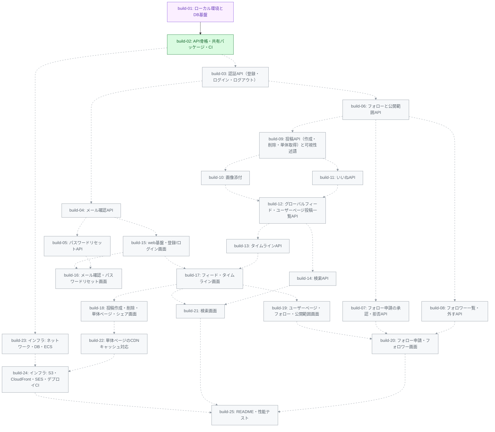

# ビルド一覧 — 001-mvp

ビルドの完了判定は `PR` 列が非空かどうかで行います。
`PR` 列の更新は当該ビルドの PR に同梱されるため、デフォルトブランチ上で
`PR` 列が埋まっていること自体がマージ済みを意味します。

依存関係のあるビルドは、先行ビルドがデフォルトブランチにマージ済みであることが必須です。
依存関係がないビルドは並行実行できます。

| buildID | title                                         | BP | dependencies       | issue                        | PR                                                                     |
| ------- | --------------------------------------------- | --- | ------------------ | ---------------------------- | ---------------------------------------------------------------------- |
| 1       | ローカル環境とDB基盤                          | 4  | —                  | [issue](./build-01/issue.md) | [#5](https://github.com/tak-solder/litmus-sns-sonnet55-hikyaku/pull/5) |
| 2       | API骨格・共有パッケージ・CI                   | 5  | 1                  | [issue](./build-02/issue.md) | —                                                                      |
| 3       | 認証API（登録・ログイン・ログアウト）         | 5  | 2                  | [issue](./build-03/issue.md) | —                                                                      |
| 4       | メール確認API                                 | 5  | 3                  | [issue](./build-04/issue.md) | —                                                                      |
| 5       | パスワードリセットAPI                         | 4  | 4                  | [issue](./build-05/issue.md) | —                                                                      |
| 6       | フォローと公開範囲API                         | 5  | 3                  | [issue](./build-06/issue.md) | —                                                                      |
| 7       | フォロー申請の承認・拒否API                   | 5  | 6                  | [issue](./build-07/issue.md) | —                                                                      |
| 8       | フォロワー一覧・外すAPI                       | 3  | 6                  | [issue](./build-08/issue.md) | —                                                                      |
| 9       | 投稿API（作成・削除・単体取得）と可視性述語   | 5  | 6                  | [issue](./build-09/issue.md) | —                                                                      |
| 10      | 画像添付                                      | 4  | 9                  | [issue](./build-10/issue.md) | —                                                                      |
| 11      | いいねAPI                                     | 3  | 9                  | [issue](./build-11/issue.md) | —                                                                      |
| 12      | グローバルフィード・ユーザーページ投稿一覧API | 4  | 10, 11             | [issue](./build-12/issue.md) | —                                                                      |
| 13      | タイムラインAPI                               | 2  | 12                 | [issue](./build-13/issue.md) | —                                                                      |
| 14      | 検索API                                       | 3  | 12                 | [issue](./build-14/issue.md) | —                                                                      |
| 15      | web基盤・登録/ログイン画面                    | 5  | 3, 4               | [issue](./build-15/issue.md) | —                                                                      |
| 16      | メール確認・パスワードリセット画面            | 5  | 15, 5              | [issue](./build-16/issue.md) | —                                                                      |
| 17      | フィード・タイムライン画面                    | 4  | 15, 13             | [issue](./build-17/issue.md) | —                                                                      |
| 18      | 投稿作成・削除・単体ページ・シェア画面        | 5  | 17, 10             | [issue](./build-18/issue.md) | —                                                                      |
| 19      | ユーザーページ・フォロー・公開範囲画面        | 4  | 17                 | [issue](./build-19/issue.md) | —                                                                      |
| 20      | フォロー申請・フォロワー画面                  | 3  | 19, 7, 8           | [issue](./build-20/issue.md) | —                                                                      |
| 21      | 検索画面                                      | 3  | 17, 14             | [issue](./build-21/issue.md) | —                                                                      |
| 22      | 単体ページのCDNキャッシュ対応                 | 5  | 18                 | [issue](./build-22/issue.md) | —                                                                      |
| 23      | インフラ: ネットワーク・DB・ECS               | 5  | 2                  | [issue](./build-23/issue.md) | —                                                                      |
| 24      | インフラ: S3・CloudFront・SES・デプロイCI     | 5  | 23, 22             | [issue](./build-24/issue.md) | —                                                                      |
| 25      | README・性能テスト                            | 4  | 14, 22, 24, 21, 20 | [issue](./build-25/issue.md) | —                                                                      |

## 依存グラフ

紫: 完了（merged） / 緑: 着手可能（ready） / グレー: 待機中（blocked）。点線は先行ビルドが未完了の依存
